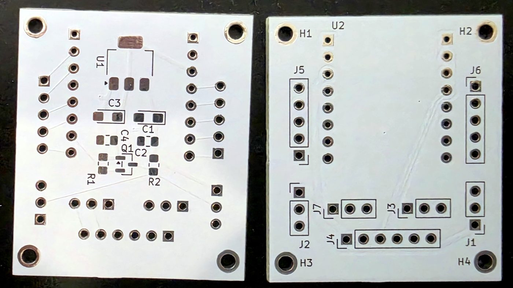
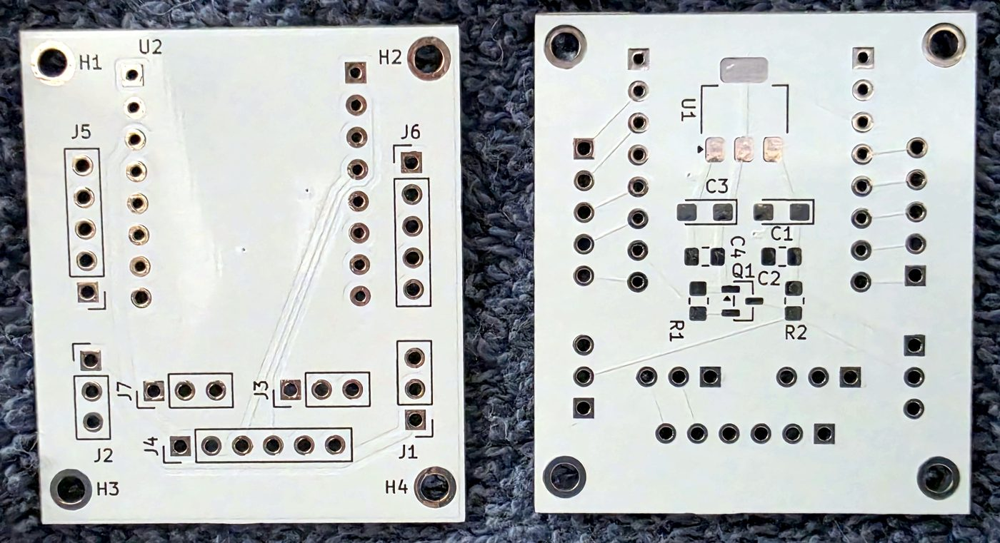
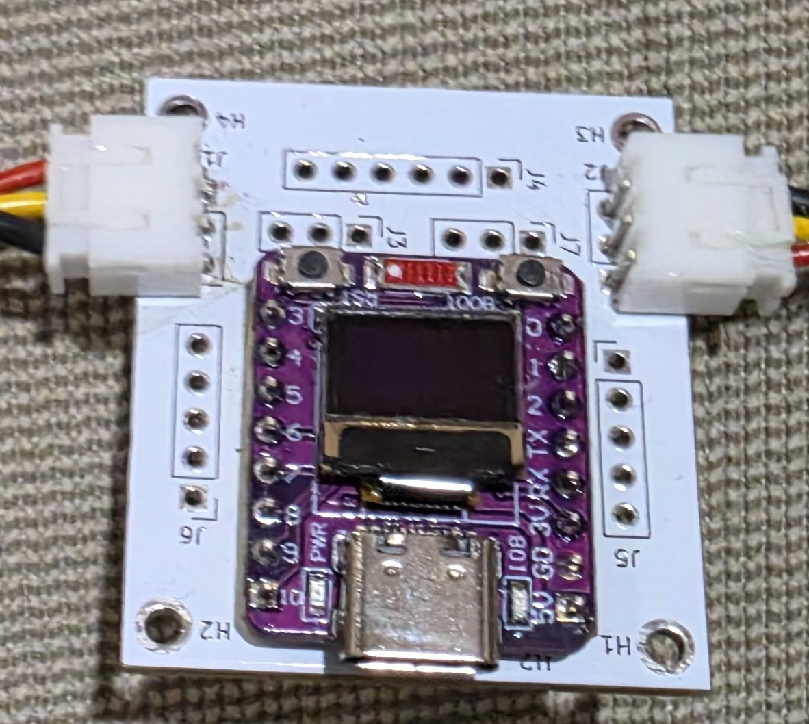
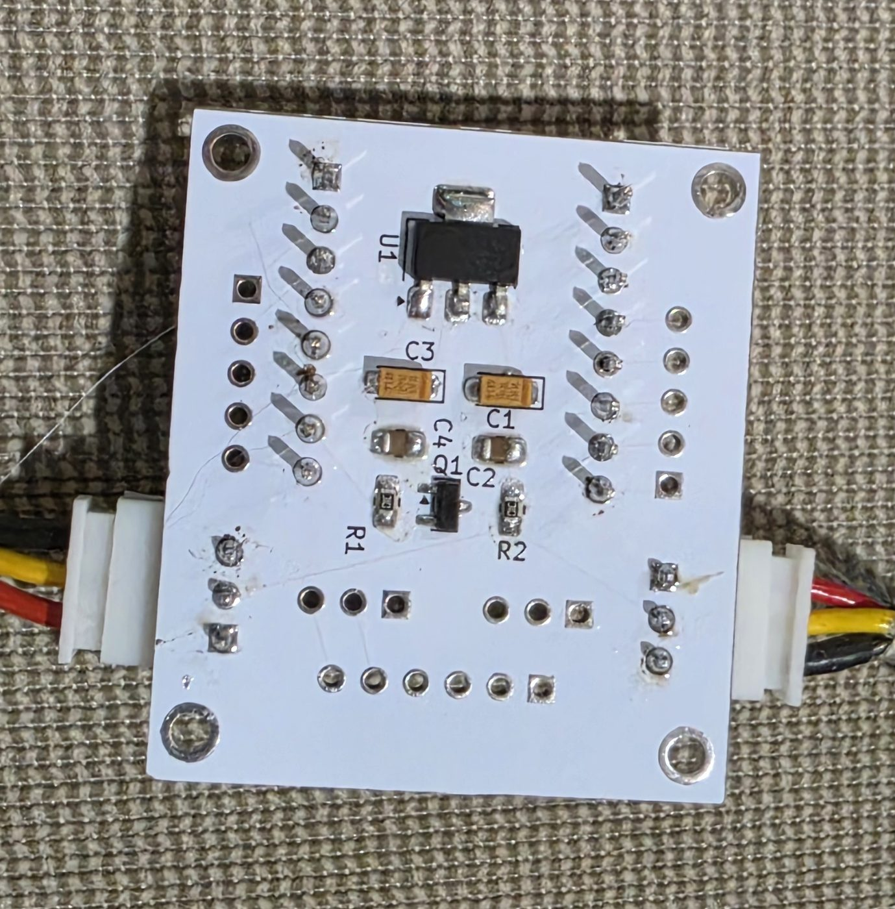
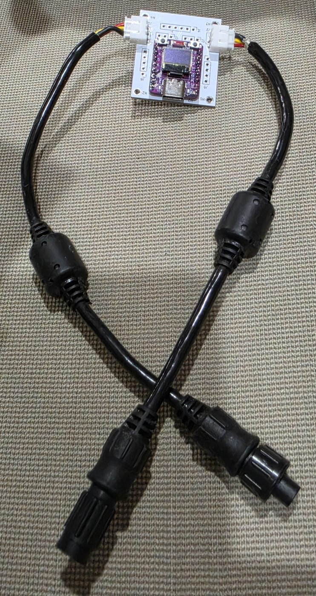
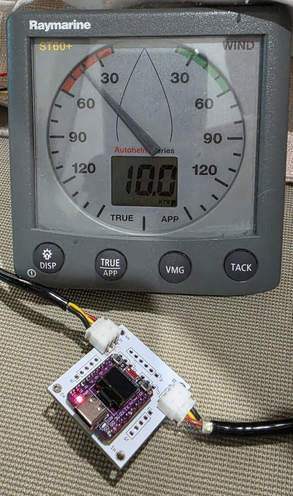
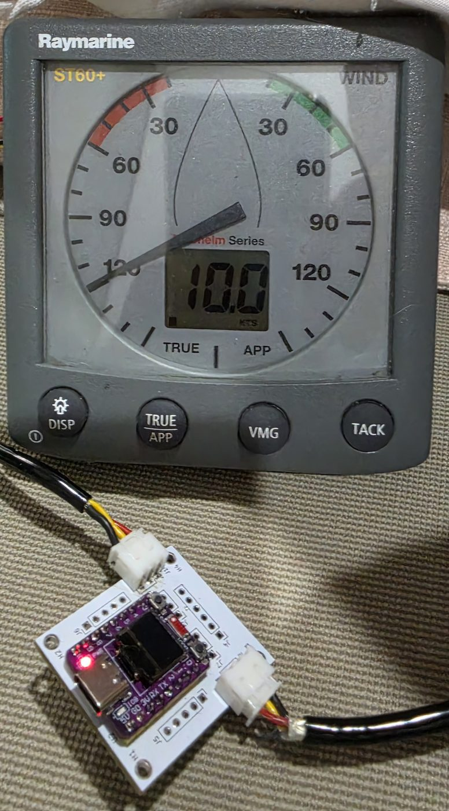
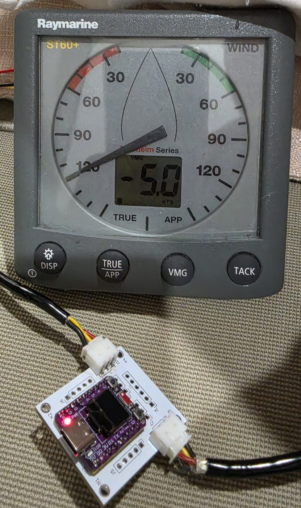

A really simple board for connecting an ESP32-C3-OLED board to seatalk as an in-path or end-of-path device.

Also has support for CAN BUS (for NEMA2000) and UART extension (which will be useful for the project revolving around using google tags as MOB tokens)

Firmware (SeaTalk/CAN/MQTT/SignalK bridge) lives in [`PlatformIO/ESP32Seatalk`](PlatformIO/ESP32Seatalk/README.md) - see that README for the MQTT topic mapping, web UI, and everything else.

## The built board

A bare board and the same board built up: an ESP32-C3 module with its small OLED sits on the carrier board
(its small display shows what the firmware is doing); the SeaTalk connectors are on the two sides, and the
voltage regulator (U1) with its capacitors, the BSS138 level shifter (Q1) for the one-wire SeaTalk line and
two resistors (R1, R2) are on the back.

| Bare PCB, component side | Bare PCB, back |
|---|---|
|  |  |

| Built: front | Built: back |
|---|---|
|  |  |

The two white 3-pin connectors (J1 and J2, the red / yellow / black leads) are SeaTalk: +12 V, data and ground.
The board takes its power from the bus, so it sits in the path of the bus or at its end. The 5-way header at the
top (J4) is where a plug-in CAN transceiver module goes, and the transceiver's CANH / CANL leave on connector
J3; neither is fitted in these photos.

### With its cables

The board with its two SeaTalk lead cables (ferrite sleeves, round screw-lock connectors), and **no NMEA 2000
transceiver fitted**: SeaTalk only.

### Driving a real instrument

The board connected to a Raymarine **ST60+ Wind** (Autohelm series) instrument on a bench SeaTalk bus. The
firmware's demo mode sends three fixed values, and the instrument works out the rest itself:

| Sent by the board | |
|---|---|
| Speed through water | 10 kn |
| Apparent wind angle | 60 deg |
| Apparent wind speed | 10 kn |

| ST60+ in APP mode | in TRUE mode | in VMG mode |
|---|---|---|
|  |  |  |
| apparent wind speed **10.0 kts** | true wind speed **10.0 kts**, true wind angle 120 deg | VMG **-5.0 kts** |

The instrument's own numbers agree with the vector calculation from the three inputs: true wind
atan2(10 sin 60, 10 cos 60 - 10) = **120 deg** at sqrt(10^2 + 10^2 - 2 x 10 x 10 x cos 60) = **10 kn**, and
VMG to the wind = STW x cos(TWA) = 10 x cos 120 = **-5.0 kn** (negative: making progress away from the wind).
